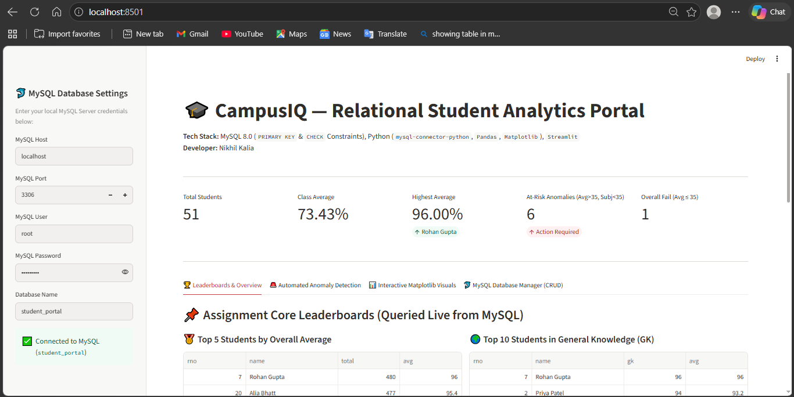

# 🎓 CampusIQ — Relational Student Analytics & At-Risk Alert Portal

[](https://www.python.org/)
[](https://streamlit.io/)
[](https://www.mysql.com/)
[](https://pandas.pydata.org/)
[](https://matplotlib.org/)

**CampusIQ** is a full-stack academic performance analytics and early-warning student intervention portal. Built on **MySQL 8.0+**, **Python (`mysql-connector-python`, `Pandas`, `NumPy`, `Matplotlib`)**, and **Streamlit**, it transforms static CSV gradebook processing into a relational, constraint-enforced database application with automated subject bottleneck detection and interactive visual analytics.

---

## 📸 Application Preview

### Main Dashboard & KPI Overview


<details>
<summary><b>🖼️ Click to View All Module Screenshots</b></summary>

#### 1. Leaderboards & Student Directory


#### 2. Automated At-Risk Anomaly Detection Engine


#### 3. Interactive Matplotlib Visual Analytics Suite


#### 4. Live MySQL Database Manager (CRUD & Constraint Validation)


</details>

---

## ✨ Key Features

1. **Relational MySQL 8.0+ Backend (`campusiq_db`)**
   - Replaces flat-file CSV reads with a normalized relational database table (`students`).
   - Enforces entity integrity via `PRIMARY KEY (rno)` and domain integrity via SQL `CHECK` constraints (`0 <= marks <= 100` across all five subjects, `0 <= total <= 500`, and `0.00 <= avg <= 100.00`).
   - Automatically initializes the schema and seeds the 50 student records from `student_reportcard.csv` on first launch.

2. **Automated At-Risk Anomaly Detection Engine**
   - Executes live SQL filtering (`WHERE avg > 35.0 AND (eng < 35 OR math < 35 OR sci < 35 OR com < 35 OR gk < 35)`) to identify "hidden risk" students who hold a passing overall average but failed an individual subject:
     - **Johnny Lever** (`rno: 50`) — Overall Avg: `74.0%` | Bottleneck: **Mathematics (`30`)**
     - **Ranbir Kapoor** (`rno: 23`) — Overall Avg: `73.6%` | Bottleneck: **English (`25`)**
     - **Arjun Kapoor** (`rno: 15`) — Overall Avg: `65.4%` | Bottleneck: **English (`34`)**
     - **Rahul Verma** (`rno: 3`) — Overall Avg: `46.4%` | Bottleneck: **Mathematics (`32`)**
     - **Rajesh Kumar** (`rno: 9`) — Overall Avg: `41.0%` | Bottleneck: **Mathematics (`28`)**
     - **Vikram Singh** (`rno: 5`) — Overall Avg: `37.2%` | Bottleneck: **General Knowledge (`30`)**

3. **SQL-Powered Academic Leaderboards**
   - Real-time queries for **Top 5 Overall Average**, **Top 3 Mathematics**, **Top 10 General Knowledge (GK)**, and the full searchable student registry.

4. **Interactive Matplotlib Visual Analytics Suite**
   - **Grouped Bar Chart:** Compare subject-by-subject scores across the Top $N$ students (`3` to `15`) ranked by any subject or overall average, complete with a `35`-mark pass threshold line.
   - **Class Average Histogram:** Analyze class score distribution with an interactive bin slider (`3` to `20` bins) and annotated class mean indicator.
   - **Subject Correlation Scatter Plot:** Explore pairwise subject relationships (e.g., Mathematics vs. Science) with automatic Pearson correlation ($r$) calculation, linear regression trendline, and highlighted diamond markers for at-risk anomaly students.
   - **Individual Student Pie Chart:** Generate exploded subject contribution breakdowns alongside an individual pass/fail report card table.

5. **Live MySQL CRUD Manager**
   - Insert new student records directly from the web UI with real-time error handling for duplicate primary keys (`MySQL Error 1062`) and out-of-range marks (`MySQL Error 3819`).

---

## 📁 Repository Structure

```text
CampusIQ/
├── assets/
│   ├── Automated Anomaly Detection.png
│   ├── Interactive Matplotlib Visuals.png
│   ├── Leaderboards & Overview.png
│   ├── Main_Dashboard.png
│   └── MySQL Database Manager.png
├── CampusIQ_app.py          # Main multi-tab Streamlit web application
├── database_setup.py        # MySQL database initializer, DDL constraints & CSV seeder
├── schema_mysql.sql         # Standalone MySQL 8.0.16+ DDL schema script
├── student_reportcard.csv   # Initial 50-student academic dataset
├── requirements.txt         # Python package dependencies
├── .gitignore               # Git ignore rules (__pycache__, .env, etc.)
└── README.md                # Project documentation
```

---

## 🛠️ Installation & Setup Guide

### Prerequisites
- **Python 3.9+** installed on your system
- **MySQL Server 8.0.16+** running locally (default: `localhost:3306`)

### 1. Clone the Repository
```bash
git clone https://github.com/<your-username>/CampusIQ.git
cd CampusIQ
```

### 2. Create a Virtual Environment & Install Dependencies
```bash
python -m venv venv

# Activate on Windows:
venv\Scripts\activate

# Activate on macOS/Linux:
source venv/bin/activate

# Install required packages:
pip install --upgrade -r requirements.txt
```

### 3. Configure MySQL Credentials & Seed the Database
You can initialize the MySQL database in **either** of two ways:

- **Option A — Directly in the Streamlit UI (Recommended):**
  Launch the application (Step 4) and enter your MySQL `Host` (`localhost`), `Port` (`3306`), `User` (`root`), and `Password` in the **CampusIQ Control Panel** sidebar. CampusIQ will automatically create `campusiq_db`, enforce the table constraints, and import all 50 student records.

- **Option B — Pre-seed via CLI (`database_setup.py`):**
  Update `DB_PASSWORD` in `database_setup.py` (or set the `MYSQL_PASSWORD` environment variable) and run:
  ```bash
  python database_setup.py
  ```

### 4. Run the Application
```bash
streamlit run CampusIQ_app.py
```
Open your browser to **`http://localhost:8501`** to explore the dashboard.

---

## 🗄️ Database Schema (`schema_mysql.sql`)

```sql
CREATE DATABASE IF NOT EXISTS campusiq_db;
USE campusiq_db;

CREATE TABLE IF NOT EXISTS students (
    rno INT PRIMARY KEY,
    name VARCHAR(100) NOT NULL,
    eng INT NOT NULL CHECK (eng >= 0 AND eng <= 100),
    math INT NOT NULL CHECK (math >= 0 AND math <= 100),
    sci INT NOT NULL CHECK (sci >= 0 AND sci <= 100),
    com INT NOT NULL CHECK (com >= 0 AND com <= 100),
    gk INT NOT NULL CHECK (gk >= 0 AND gk <= 100),
    total INT NOT NULL CHECK (total >= 0 AND total <= 500),
    avg DECIMAL(5,2) NOT NULL CHECK (avg >= 0.00 AND avg <= 100.00)
);
```

---